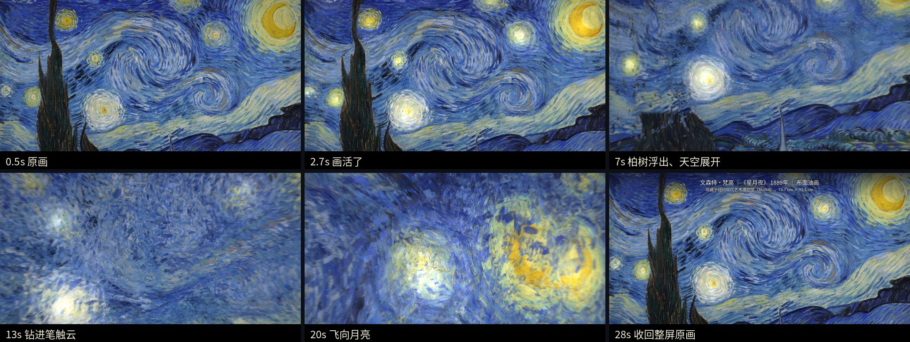

# 名画漫游 · Painting Fly-through

把一幅名画"打开"：画面先活过来，然后从平面展开成立体空间，第一人称在画里穿行，最后收回成整屏原画。
全程一个镜头，不靠硬切，2D 和 3D 之间是同一个画面的连续变化。

适合抖音 / 小红书 / B 站横屏短视频（30–40 秒，1080p，无声，配乐后期自己加）。整条流程只用公版画作、开源模型和代码，**不需要 3D 建模，不需要显卡**（有显卡会快很多）。



## 流程总览


每一步的输入、输出、参数和检查点见 **[docs/WORKFLOW.md](docs/WORKFLOW.md)**。

## 快速开始：一键做《星月夜》

```bash
# 1. 环境（Python 3.10+、Node 18+、ffmpeg、Chrome/Chromium、中文字体）
pip install -r requirements.txt          # 只有 CPU 时：pip install torch --index-url https://download.pytorch.org/whl/cpu
cd web && npm install && cd ..           # three.js + playwright-core
# Linux 字体：sudo apt install fonts-noto-cjk ；macOS 用 caption.py --font 指向苹方等字体

# 2. 跑流水线（下载 → 深度 → 预处理 → 关键帧预览 → 渲染 → 字幕 → 编码）
pipelines/starry_night.sh preview        # 先只到预览，看 frames/starry_preview/ 里的 8 张关键帧
pipelines/starry_night.sh                # 全部跑完，成片在 out/starry_night_1080p.mp4

# 有显卡的电脑加 GPU=1；想先快速看效果用 W=960 H=540
GPU=1 pipelines/starry_night.sh render
```

单独渲染某几秒的静帧用来调镜头：

```bash
node web/render.js --cut starry --out frames/check --w 960 --h 540 --times 6.5,15,23.6
```

渲染速度参考：纯 CPU（2 核 Linux，SwiftShader 软件渲染）1080p 约 3.5 秒/帧，32 秒视频约 1 小时；中断后重跑会跳过已经渲染好的帧。

## 仓库结构

```
pipelines/          一键流水线：starry_night.sh（推荐模板）、monet_assets.sh（莫奈示例素材）
scripts/
  fetch_wikimedia.py   下载公版画作（自动检查许可证）
  depth.py             单目深度估计（Depth Anything V2）
  prep_world.py        画 + 深度 → 深度网格、背景层、笔触粒子（通用）
  paintings/           每幅画专属的预处理（starry_night.py 是模板）
  caption.py           烧录画作信息字幕
  retime.py            变速：重点常速、铺垫加速，平滑过渡
  encode.sh            帧序列 → MP4（控制码率/体积）
  extras/              莫奈示例用的额外素材（笔触地形、睡莲水面、开放世界）
web/
  film.js              渲染引擎 + 所有镜头时间线（three.js）
  openworld.js         程序化"莫奈山谷"（开放世界实验版）
  render.js            无头浏览器逐帧渲染（自带静态服务器）
  data/worlds.json     每幅画的深度/相机参数
docs/
  WORKFLOW.md          完整流程：每一步做什么、怎么检查
  DESIGN.md            视觉设计原则：2D/3D 衔接、转场、节奏（从反复迭代里总结的）
  STORYBOARDS.md       分镜模板 + 星月夜 / 莫奈分镜实例
  NEW_PAINTING.md      换一幅画要改哪些地方
  REFERENCE.md         引擎参数速查（worlds.json、镜头对象、着色器控制量）
  TROUBLESHOOTING.md   常见画面瑕疵和解决办法
```

## 已有的镜头（`--cut`）

| cut | 时长 | 内容 | 素材 |
|---|---|---|---|
| `starry` | 32 秒 | 梵高《星月夜》：画活了 → 展开 → 穿笔触云 → 飞向月亮 → 收回整屏原画 | `pipelines/starry_night.sh` |
| `fusion2` | 38.5 秒 | 莫奈：展厅画框缓缓铺开成《花园小径》→ 睡莲水面 → 日本桥 → 整屏《睡莲池》 | `pipelines/monet_assets.sh` |
| `fusion` | 30 秒 | 同上，无展厅开场 | 同上 |
| `short` | 28 秒 | 《睡莲池》高速穿行 → 退出画框 → 画作字幕 | 同上 |
| `open` | 34 秒 | 程序化莫奈山谷航拍 + 飞进悬浮画作（实验版，效果不如融合版） | 同上 |
| `monet` | 2 分钟 | 最早的完整版：展厅 → 开画 → 光影一天 → 笔触星球 → 四季花园 | 同上 |

## 版权与发布

- **画作**：只用已进入公有领域的作品（多数国家和地区是作者去世满 50–70 年，并且 Commons 上标注 Public domain）。`fetch_wikimedia.py` 会打印许可证，不是公版会警告。
- **深度模型**：Depth-Anything-V2-Small 是 Apache-2.0；Base/Large（默认用 Base，轮廓更干净）是 CC-BY-NC-4.0，只限非商业用途。商用请加 `--model depth-anything/Depth-Anything-V2-Small-hf`。
- **音乐**：成片是无声的。配乐请用平台曲库或已获授权的音乐。
- **AI 标注**：发抖音时勾选"内容由 AI 生成"。
- **字幕信息**：馆藏地、年代、尺寸请到博物馆官网核对后再发。

## 致谢

[Depth Anything V2](https://github.com/DepthAnything/Depth-Anything-V2) · [three.js](https://threejs.org) · [Playwright](https://playwright.dev) · 画作图像来自 [Wikimedia Commons](https://commons.wikimedia.org)（Google Art Project、芝加哥艺术博物馆等的公版数字化图像）
